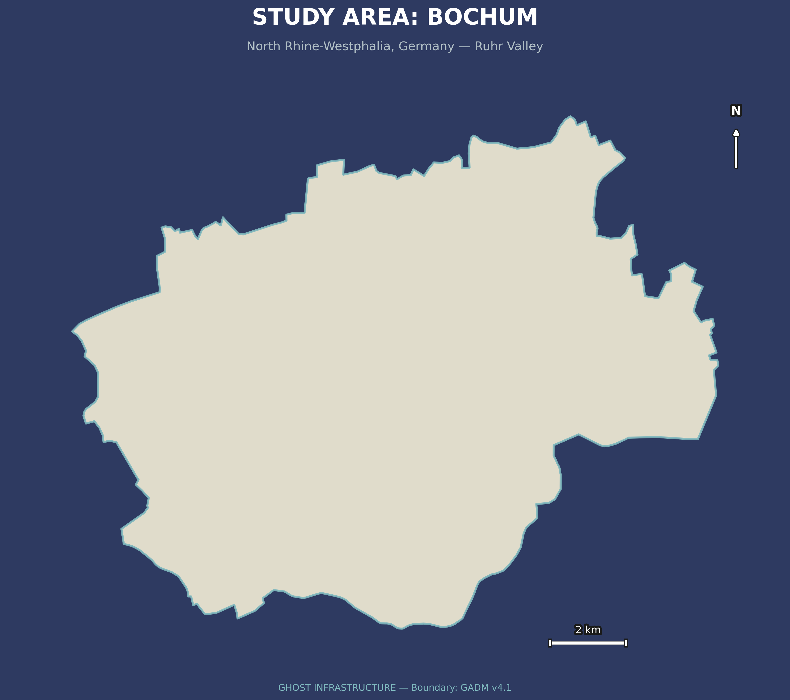
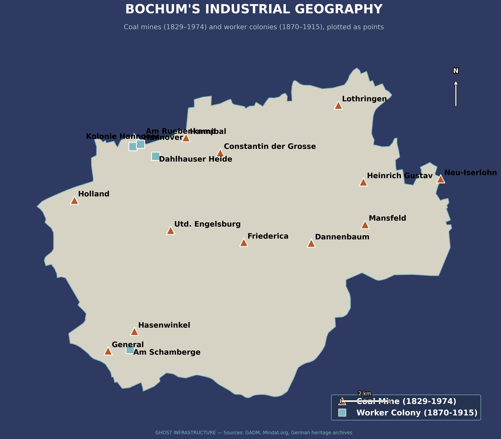
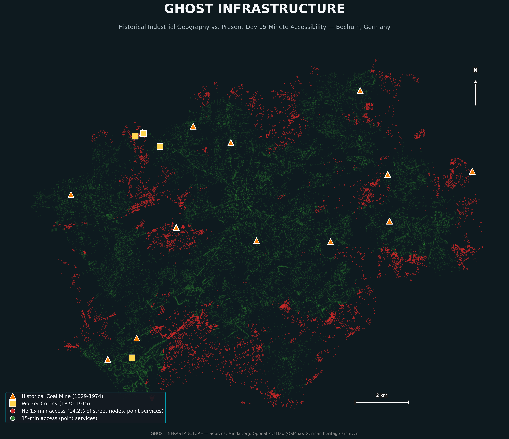
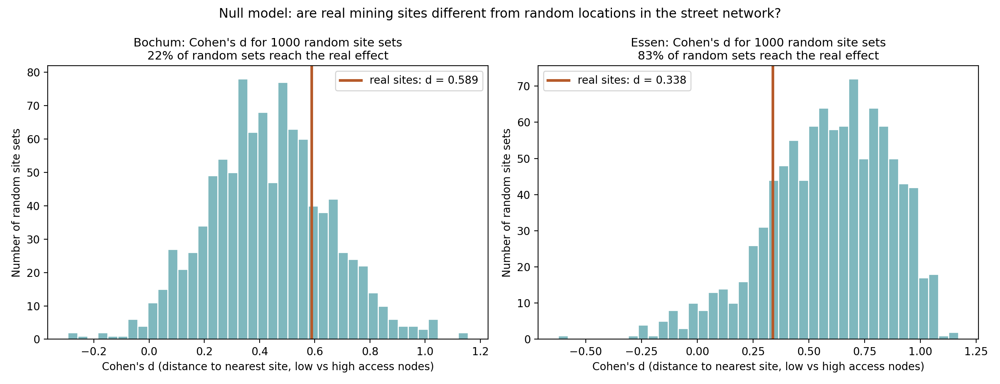
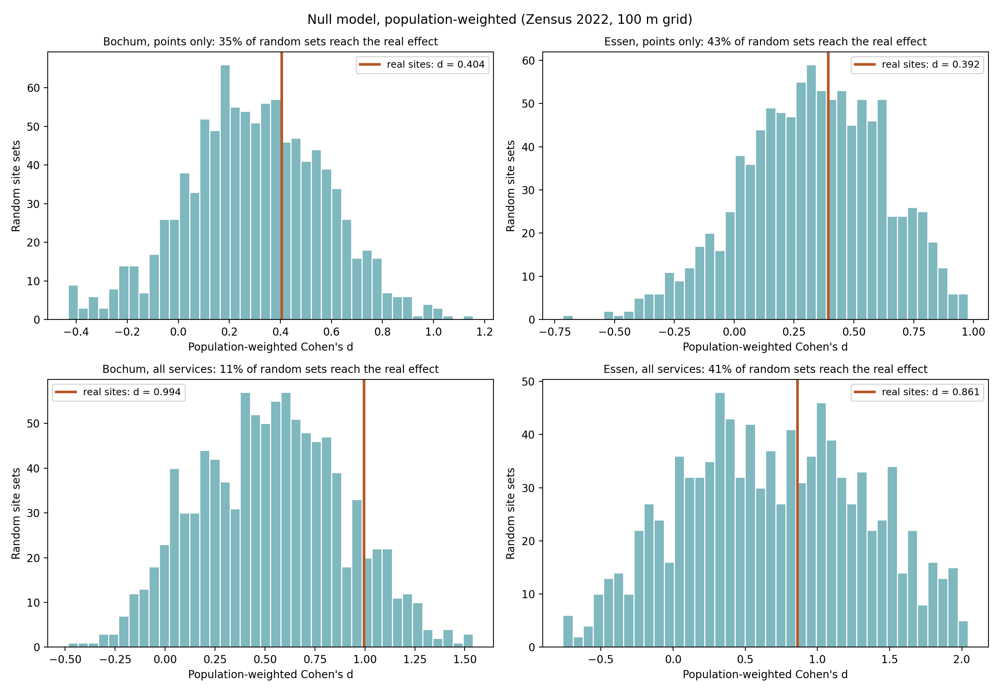
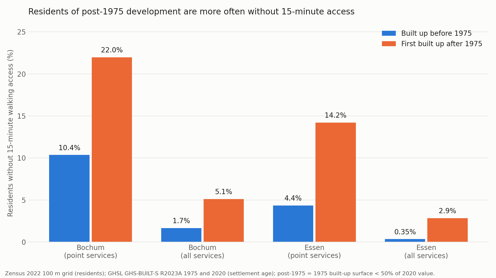

# Ghost Infrastructure? Testing Whether 19th-Century Coal-Mining Geography Shapes 15-Minute Walking Access in Bochum and Essen, Germany

**Sakshi D. Maske**
Independent Geospatial Researcher

*Version 2.0 (October 2026). This version replaces v1.1 after a full internal review; Section 9 lists what changed and why.*

## Abstract

Cities of the Ruhr were built around coal mines and workers' housing colonies, and it is often assumed that this industrial past still shapes which neighbourhoods are well served today. This study asks a single question: is present-day 15-minute walking access in Bochum and Essen associated with the location of historical coal-mining sites, beyond what general urban form explains? Seventeen major mine and colony sites in Bochum and eight in Essen were compiled from documentary sources. Walking access to essential services was modelled on the full OpenStreetMap pedestrian network (69,393 and 72,027 nodes). Residents were counted from the Zensus 2022 100 m grid, and settlement age was taken from the satellite-derived GHSL built-up surface for 1975 and 2020. A naive comparison suggests a strong "legacy" effect: street nodes without access lie farther from the historical sites (Cohen's d = 0.589 in Bochum). However, a null model shows that 1,000 random sets of 17 locations drawn from the same street network reproduce an effect at least this large 22.5% of the time (83.1% in Essen). Once access is measured for residents rather than street nodes, the real sites are not distinguishable from random built-up locations in either city, under either service definition. The apparent legacy signal is therefore best explained by general urban form: almost any location inside the built-up area is close to well-served streets, while gaps sit at the low-density edge. What does distinguish the gaps is settlement age. Residents of areas first built up after 1975 are two to eight times more likely to lack 15-minute access than residents of older areas, in both cities. With all mapped services counted, only 2.1% of Bochum's and 0.69% of Essen's residents lack such access. The study shows why claims of industrial legacy need a null model and a population-based outcome before they are accepted.

**Keywords:** 15-minute city; walking accessibility; path dependence; historical GIS; null model; Monte Carlo; GHSL; Zensus 2022; Ruhr

---

## 1. Introduction

The Ruhr is one of Europe's classic old-industrial regions. In cities such as Bochum and Essen, collieries, railways and company housing colonies (Zechensiedlungen) set much of the urban pattern between the mid-19th and mid-20th centuries, and the last mines closed decades ago. A common intuition, in planning debates and in the path-dependence literature alike, is that such an industrial past leaves a lasting spatial imprint. Former mining districts may be either neglected or, conversely, may have inherited dense, well-connected urban fabric.

At the same time, the "15-minute city" has become a widely used way to describe everyday accessibility: whether residents can reach essential services within a short walk (Moreno et al., 2021; Logan et al., 2022). If industrial history shapes the city, it could shape this kind of access too.

Testing such a legacy claim is harder than it looks. Historical industrial sites lie inside the built-up city, and access to services is, almost by definition, better inside the built-up city than at its edges. A positive association between proximity to old mines and good access is therefore expected even if the mines themselves played no role. The question is not whether such an association exists, but whether it is larger than what any comparable set of locations would produce.

**Research question.** *Is present-day 15-minute walking access in Bochum and Essen associated with the location of historical coal-mining sites, beyond what general urban form explains, and, if not, what does distinguish the places where access is missing?*

Two hypotheses follow:

- **H1 (industrial legacy).** Access is better near historical mine and colony sites than near comparable random locations in the built-up city, also when access is counted for residents and when urban form is controlled for. *H0:* the real sites are not distinguishable from random built-up locations.
- **H2 (settlement age).** Residents of areas first built up after 1975 are more likely to lack 15-minute access than residents of older areas.

The contribution is twofold. Substantively, the study tests an industrial-legacy claim for walking access in two Ruhr cities with a design that can reject it. Methodologically, it shows how much an apparent legacy effect depends on three choices that are often left implicit: the comparison set (a random-location null model rather than a simple group comparison), the unit of analysis (residents rather than street-network nodes), and the measurement of services. It also adds an Earth-observation layer (GHSL) to locate where access gaps actually are.

The decision rules for interpreting the results (Section 3.8) were fixed before the population-weighted and settlement-age analyses were run.

## 2. Background

### 2.1 Path dependence and the persistence of urban form

Path dependence describes how early, partly accidental decisions lock in later development (Arthur, 1988; Martin & Sunley, 2006). In urban economics, persistence has been tested with natural experiments: Japanese city sizes recovered after wartime bombing (Davis & Weinstein, 2002), and towns at historical portage sites kept their advantage long after portage lost its purpose (Bleakley & Lin, 2012). For the Ruhr, the classic argument is one of institutional and industrial lock-in (Grabher, 1993), and later work examines how industrial culture shapes renewal or persistence (Görmar & Harfst, 2019). Comparable arguments have been made for the infrastructure of port cities (Hein & Schubert, 2021). These studies share a demanding standard: a persistence claim requires a credible counterfactual, not just a correlation with present-day outcomes.

### 2.2 The 15-minute city and the measurement of access

Accessibility, the ease of reaching opportunities, has long been central to urban analysis (Hansen, 1959; Geurs & van Wee, 2004). The 15-minute city frames it as the share of daily needs that residents can reach on foot or by bicycle within about a quarter of an hour (Moreno et al., 2021). Empirical studies increasingly measure it on real street networks rather than with straight-line buffers (Logan et al., 2022; Omwamba et al., 2025), apply it to specific service types (Moreno et al., 2025), and compare cities at scale. In a study of thousands of cities worldwide, accessibility was systematically higher in central areas than at the periphery (Bruno et al., 2024). This centre-periphery gradient is the main reason why any set of sites inside the built-up city can appear to "predict" good access.

### 2.3 Testing spatial associations

Two statistical problems are well known in spatial analysis. First, nearby observations are not independent, so tests that treat each location as a separate sample overstate certainty (Dormann et al., 2007). Second, the right comparison for a spatial pattern is often a Monte Carlo null model: the observed configuration is compared with many randomly generated configurations under the same constraints (Besag & Diggle, 1977). Local indicators of spatial association (Anselin, 1995) describe where values cluster, but on their own they do not test what causes the clustering.

### 2.4 Historical GIS and Earth observation

Historical GIS combines archival information with present-day spatial data (Gregory & Ell, 2007). Earth-observation products now allow settlement growth to be dated consistently across decades. The Global Human Settlement Layer (GHSL) provides built-up surface estimates from Landsat and Sentinel-2 imagery for epochs from 1975 onward (Pesaresi & Politis, 2023; Pesaresi et al., 2024), which makes it possible to distinguish older from newer development without local building-age records.

## 3. Data and methods

### 3.1 Study areas

Bochum (about 354,000 residents in the Zensus 2022 grid used here) and Essen (about 571,000) are neighbouring cities in North Rhine-Westphalia, Germany; Essen lies about 15 km west of Bochum. Both grew around coal mining from the mid-19th century. City boundaries are taken from GADM v4.1 (level 4).

  

**Figure 1.** Bochum, the primary study area (administrative boundary, GADM v4.1).

### 3.2 Historical sites

For Bochum, 13 major coal mines and 4 worker colonies were compiled: mine coordinates from Mindat.org, and colony coordinates from Wikipedia, the Route Industriekultur and ruhr-bauten.de. For Essen, 4 mines and 4 colonies were compiled from KuLaDig (the North Rhine-Westphalia cultural-heritage information system) and German Wikipedia. Only large, well-documented sites were included. Smaller operations in the cities' full mining registers (several hundred in Bochum and around 1,700 mining-related locations in Essen) were not. Sites are represented as points. They were not digitized from georeferenced historical maps.

  

**Figure 2.** The 13 coal mines and 4 worker colonies in Bochum, plotted as points on the current city boundary.

### 3.3 Street network and services

The pedestrian networks were downloaded from OpenStreetMap with OSMnx (Boeing, 2017): Bochum on 18 July 2026 (69,393 nodes, 169,668 edges) and Essen on 13 August 2026 (72,027 nodes, 188,198 edges). Each network forms a single connected component. Essential services were requested in eight categories: hospitals, clinics, pharmacies, schools, kindergartens, supermarkets, convenience stores and parks. Two service definitions are used throughout:

- **Point services** (the definition of v1): only features mapped as points. This is 248 of 786 features in Bochum and 366 of 1,410 in Essen. In Bochum, every hospital and every park, and most schools, are mapped as polygons, so they are absent from this definition.
- **All services:** every feature, with polygons represented by their centroid.

### 3.4 Accessibility

Each service is snapped to its nearest network node. A multi-source shortest-path search then marks every node within 1,125 m of network distance of at least one service (15 minutes at 75 m per minute). The outcome is binary: access or no access. Distances from each location to the nearest historical site and to the city centre are straight-line (Euclidean) distances in EPSG:32632. The centre is a point in central Bochum (7.2162°E, 51.4818°N, near the Rathaus) and Essen Hauptbahnhof.

### 3.5 Population

Residents are taken from the Zensus 2022 100 m grid (reference date 15 May 2022; Statistisches Bundesamt, 2024). Populated cells whose centre lies inside the city boundary are used: 6,924 cells and 353,661 residents in Bochum, and 9,755 cells and 571,031 residents in Essen. Each cell takes the access value of the network node nearest its centre; the median distance to that node is 22 m in Bochum and 29 m in Essen.

### 3.6 Settlement age (Earth observation)

Settlement age comes from GHSL GHS-BUILT-S R2023A (Pesaresi & Politis, 2023), which gives built-up surface per 100 m cell for 1975 and 2020. A populated cell is classed as **post-1975** if its built-up surface in 1975 was less than half its 2020 value, and as **pre-1975** otherwise. Cells with no built-up surface in 2020 cannot be classified and are excluded: 50 cells (418 residents) in Bochum and 69 cells (384 residents) in Essen.

### 3.7 Analyses

1. **Naive comparison (as in v1).** Distance to the nearest site is compared between nodes with and without access, using Welch's t-test and Cohen's d. A logistic regression of access on distance to the nearest site and distance to the centre is also fitted.
2. **Null model.** One thousand random sets of the same number of sites (17 in Bochum, 8 in Essen) are drawn from the street-network nodes, which stand in for "locations in the built-up city" (seed 42). For each set, Cohen's d and the regression coefficient are recomputed. The share of random sets that reach the observed value serves as an empirical p-value.
3. **Urban-form controls and spatial dependence.** The regression adds distance to the city boundary and the number of street nodes within 500 m (an urban-density proxy), and the null model is applied to the resulting coefficient. A grid-cluster bootstrap with 2 km cells (999 resamples) and a leave-one-site-out check address spatial dependence and the influence of individual sites.
4. **Service definition.** Analyses 1 and 2 are repeated with all services.
5. **Population weighting.** For residents, population-weighted Cohen's d is computed, with a null model whose 1,000 random site sets are drawn from populated cells. A population-weighted logistic regression controls for distance to the centre and the number of residents within 500 m. Both service definitions are used.
6. **Settlement age.** The share of residents without access is compared between pre- and post-1975 cells, and the post-1975 flag is added to the population-weighted regression.

### 3.8 Decision rules (fixed in advance)

H1 is supported for a city only if the real sites beat at least 95% of random site sets, consistently across both service definitions **and** in the population-weighted analysis. Otherwise, the result is reported as "explained by general urban form" or as mixed. No analysis was added after the results were seen. The specification and its timeline are recorded in `DEFENSIBILITY_PLAN.md`.

### 3.9 Software and reproducibility

The analysis uses Python with OSMnx, NetworkX, GeoPandas, SciPy and statsmodels (Seabold & Perktold, 2010); Local Moran's I in v1 used PySAL (Rey et al., 2022). All scripts, inputs and frozen outputs are in the project repository (`robustness_v2.py`, `robustness_v2_population.py`, `robustness_v2_settlement_age.py`).

## 4. Results

### 4.1 Coverage: street nodes versus residents

With point services, 85.8% of Bochum's street nodes and 88.5% of Essen's have 15-minute access. With all services, these figures rise to 96.7% and 97.7%. Counted for residents, the gaps are smaller still:

**Table 1.** Share of residents without 15-minute access.

| | Bochum | Essen |
|---|---|---|
| Point services | 11.7% (41,521 residents) | 5.6% (32,228) |
| All services | 2.1% (7,315) | 0.69% (3,958) |

Many street nodes without access lie where few or no people live. The median distance to the city boundary is 1,064 m for nodes without access versus 1,925 m for nodes with access in Bochum. The median number of street nodes within 500 m is 244 versus 568.

  

**Figure 3.** Bochum street nodes with (green) and without (red) 15-minute access to a point-mapped service, with the historical sites.

### 4.2 The naive comparison

The v1 result is reproduced exactly. In Bochum, nodes without access lie on average 1,984 m from the nearest historical site, versus 1,450 m for nodes with access (Welch's t = 42.887, Cohen's d = 0.589). In Essen, the figures are 3,693 m versus 3,130 m (t = 24.732, d = 0.338). The direction holds at 10- and 20-minute thresholds in Bochum (d = 0.413 and 0.661).

The regression coefficient for distance to the nearest site, controlling for distance to the centre, is -4.76e-4 per metre in Bochum. In Essen it is +1.14e-4, so there the sign reverses (distance to site and to centre correlate at r = 0.405 in Essen, versus 0.063 in Bochum). Taken at face value, the Bochum numbers look like strong evidence for an industrial legacy.

### 4.3 Null model: real sites versus random locations

**Table 2.** Real sites compared with 1,000 random site sets drawn from the street network.

| | Bochum | Essen |
|---|---|---|
| Observed Cohen's d (point services) | 0.589 | 0.338 |
| Mean d of random sets [5th–95th percentile] | 0.430 [0.080, 0.790] | 0.589 [0.082, 0.977] |
| Random sets with a positive "reversed" effect | 98.1% | 96.7% |
| Random sets with d ≥ observed | **22.5%** | **83.1%** |
| Random sets with a coefficient ≤ observed (centre controlled) | 34.4% | 82.9% |

Almost every random set of locations shows the "reversed" pattern. The real Bochum sites sit in the upper part of the random distribution but well within it: about one random set in five does as well. In Essen, the real sites do worse than most random sets.

  

**Figure 4.** Cohen's d for 1,000 random site sets (bars) and for the real historical sites (line), street-node level, point services.

### 4.4 Urban form and spatial dependence

Adding distance to the boundary and local street density shrinks the Bochum coefficient from -4.76e-4 to -1.57e-4. Random site sets reach that value 25.4% of the time (Essen: -6.28e-5, 35.6%). The grid-cluster bootstrap gives a 95% interval for the raw distance difference of [197 m, 907 m] in Bochum (52 cells) and [-2 m, 1,147 m] in Essen (75 cells). The difference is therefore real as a description, but not specific to mining sites. Leaving out one site at a time gives d between 0.369 and 0.697 in Bochum, and between 0.011 and 0.450 in Essen, where a single site drives most of the effect.

The sites themselves are not uniformly well served. In Bochum, 5 of the 17 sites have fewer than half of the street nodes within 750 m covered: Hannover (36.3%), Utd. Engelsburg (33.3%), Neu-Iserlohn (0%), Kolonie Hannover (34.2%), Am Ruebenkamp (42.4%). Three of the four worker colonies are among them, so the residential part of the industrial legacy is, if anything, less well served than average.

### 4.5 Service definition

With all services, Bochum's naive effect becomes larger (d = 1.499), and the real sites beat 95.7% of random sets (random sets with d ≥ observed: 4.3%). This is the only node-level result that crosses the 95% line. In Essen, the real sites remain unremarkable (d = 0.532; 77.7% of random sets reach it). Under the decision rule, this Bochum result counts only if it also holds for residents.

### 4.6 Population-weighted results

**Table 3.** Residents: real sites compared with 1,000 random site sets drawn from populated cells.

| | Bochum, point | Bochum, all | Essen, point | Essen, all |
|---|---|---|---|---|
| Weighted d, real sites | 0.404 | 0.994 | 0.392 | 0.861 |
| Mean d of random sets | 0.299 | 0.527 | 0.327 | 0.694 |
| Random sets with d ≥ real | 35.2% | 10.6% | 43.0% | 41.3% |
| Random sets with coefficient ≤ real (centre and resident density controlled) | 58.6% | 23.6% | 35.7% | 34.2% |

None of the four cases reaches the 95% line. The Bochum all-services signal from Section 4.5 falls to the 89.4% level once residents rather than street nodes are counted. **H0 is not rejected in either city.**

  

**Figure 5.** Population-weighted null model for both cities and both service definitions.

### 4.7 Settlement age

**Table 4.** Residents without 15-minute access by settlement age (GHSL).

| | Bochum, point | Bochum, all | Essen, point | Essen, all |
|---|---|---|---|---|
| Pre-1975 cells | 10.4% | 1.7% | 4.4% | 0.35% |
| Post-1975 cells | **22.0%** | **5.1%** | **14.2%** | **2.9%** |
| Odds ratio of access, post-1975 (adjusted) | 0.939 | 0.873 | 0.900 | 0.379 |

Post-1975 cells hold 11.8% of Bochum's residents and 12.9% of Essen's. In all four cases, these residents are two to eight times more likely to lack 15-minute access, and the adjusted odds ratio is below 1. **H2 is supported.** The regression treats each resident as an observation and ignores spatial dependence, so its p-values are over-confident and are not used; the consistent direction and the size of the rate differences carry the result.

  

**Figure 6.** Share of residents without 15-minute access in areas built up before and after 1975.

## 5. Discussion

The answer to the research question is no. In neither city are historical coal-mining sites associated with 15-minute access beyond what general urban form explains. The naive result that motivated v1 of this study is real as a description: places near the old sites do have better access on average. But it is not specific to mining. Almost any set of locations inside the built-up city produces the same pattern, because access is better inside the city than at its low-density edges, and the historical sites lie inside the city.

Two parts of the result are robust. First, the unit of analysis matters a great deal. Most street nodes without access are footpaths and tracks in forests, fields and along the Ruhr valley, where few people live. Counted for residents, access gaps shrink to a few percent, and the apparent legacy effect disappears. Second, the gaps that remain are concentrated in newer development. Residents of areas first built up after 1975 are consistently more likely to lack walking access. This fits the familiar pattern of later, lower-density and more car-oriented suburban growth at the city edge, although the data here describe where gaps are, not why.

Path-dependence arguments are not refuted by this study; the historical layer is too thin for that (Section 6). What the study shows is that, for walking access in these two cities, a simple proximity test cannot separate an industrial legacy from general urban form. A credible legacy claim would need a counterfactual comparable to those used in the persistence literature (Davis & Weinstein, 2002; Bleakley & Lin, 2012), not only a correlation.

For planning, the evidence supports a modest conclusion. Improving 15-minute access is mainly a question for the post-1975 periphery, not for the historical mining districts as such. The analysis does not show that heritage-led regeneration of mining districts is unnecessary or that it would improve access.

## 6. Limitations

- **Historical layer.** Only 17 (Bochum) and 8 (Essen) large sites were used, from secondary sources and as points. Their selection favours well-documented sites, which may themselves be the ones best integrated into today's city. A fuller register, mapped footprints, or historical rail and road networks could change the exposure measure.
- **Accessibility measure.** Access is binary (at least one service of any type within 1,125 m), all services are weighted equally, and polygon services are represented by centroids rather than entrances. OSM completeness and tagging style differ between cities, which is one reason why both service definitions are reported.
- **Distances.** Distances to sites and to the centre are straight-line. A single centre point simplifies two polycentric cities.
- **Population data.** Zensus grid values are slightly perturbed for confidentiality (cell-key method) and empty cells are not published. The Zensus (2022), network (2026) and GHSL (1975 and 2020) dates differ.
- **Settlement age.** The 50% rule is one simple definition of post-1975 development, and GHSL built-up surface is a satellite-derived estimate, not a building-age record. The settlement-age result is a consistent association, not a causal effect, and its regression p-values are over-confident.
- **Scope.** Two cities, one point in time, and no socioeconomic variables (income, age structure, car ownership).

## 7. Conclusion

A widely held intuition, that a city's coal-mining past shapes who can walk to everyday services today, does not survive a test against random locations in Bochum or Essen. The apparent legacy signal is explained by general urban form. Where access gaps exist, they are concentrated among residents of areas built up after 1975, and they are small when all mapped services are counted. More broadly, legacy claims in urban accessibility should be tested against a null model and on a population basis before they are accepted.

## 8. Future work

- Expand the historical layer: full mine registers, mapped site footprints, and historical rail and road networks from georeferenced maps.
- Extend the comparison to further Ruhr cities with the same design.
- Use a graded accessibility measure (number of service types, travel time) and socioeconomic data from the Zensus grid.
- Model settlement age with additional GHSL epochs to track when access gaps emerged.

## 9. Changes from version 1.1

Version 1.1 reported the naive comparison (Section 4.2) as evidence of a "path dependency of centrality". An internal forensic review in October 2026 found that this claim had not been tested against random locations, and the analysis was redesigned. In summary:

- **Services.** v1.1 stated that 786 point services were used; in fact only the 248 point-mapped services were used. Both definitions are now reported.
- **Local Moran's I.** v1.1 presented Local Moran's I on the binary access variable as independent corroboration ("97.1% of low-access nodes in cold-spot clusters"). For a binary outcome built from contiguous service catchments, this result follows mechanically from how the variable is constructed, so it is no longer used as evidence.
- **Bootstrap description.** The network-block bootstrap of v1.1 was described as limited by network fragmentation. The network is in fact a single connected component; the bootstrap is replaced here by a grid-cluster bootstrap and, more importantly, by the null model.
- **Essen.** v1.1 described the Essen result as a partial replication that "strengthens the core idea". With the null model, Essen does not replicate.
- **New data.** Zensus 2022 population and GHSL settlement age were added; the policy claim of v1.1 is now tested rather than asserted.

## Data availability and attribution

Code, inputs and outputs are available at [github.com/sakshimaske303-commits/GHOST_INFRASTRUCTURE](https://github.com/sakshimaske303-commits/GHOST_INFRASTRUCTURE).

- Street network and services: © OpenStreetMap contributors, available under the Open Database Licence (ODbL).
- Population: Zensus 2022, © Statistische Ämter des Bundes und der Länder, Datenlizenz Deutschland – Namensnennung 2.0 (dl-de/by-2-0).
- Built-up surface: GHSL, © European Union 2023, reuse authorised with acknowledgement.
- Boundaries: GADM v4.1. GADM files are not redistributed in the repository; a script extracts the city boundaries from the user's own GADM download.

## References

Anselin, L. (1995). Local indicators of spatial association—LISA. *Geographical Analysis*, 27(2), 93–115. https://doi.org/10.1111/j.1538-4632.1995.tb00338.x

Arthur, W. B. (1988). Urban systems and historical path dependence. In J. H. Ausubel & R. Herman (Eds.), *Cities and their vital systems: Infrastructure past, present, and future* (pp. 85–97). National Academy Press. https://nap.nationalacademies.org/read/1093/chapter/5

Besag, J., & Diggle, P. J. (1977). Simple Monte Carlo tests for spatial pattern. *Applied Statistics*, 26(3), 327–333. https://doi.org/10.2307/2346974

Bleakley, H., & Lin, J. (2012). Portage and path dependence. *The Quarterly Journal of Economics*, 127(2), 587–644. https://doi.org/10.1093/qje/qjs011

Boeing, G. (2017). OSMnx: New methods for acquiring, constructing, analyzing, and visualizing complex street networks. *Computers, Environment and Urban Systems*, 65, 126–139. https://doi.org/10.1016/j.compenvurbsys.2017.05.004

Bruno, M., Melo, H. P. M., Campanelli, B., & Loreto, V. (2024). A universal framework for inclusive 15-minute cities. *Nature Cities*, 1(10), 633–641. https://doi.org/10.1038/s44284-024-00119-4

Davis, D. R., & Weinstein, D. E. (2002). Bones, bombs, and break points: The geography of economic activity. *American Economic Review*, 92(5), 1269–1289. https://doi.org/10.1257/000282802762024502

Dormann, C. F., McPherson, J. M., Araújo, M. B., et al. (2007). Methods to account for spatial autocorrelation in the analysis of species distributional data: A review. *Ecography*, 30(5), 609–628. https://doi.org/10.1111/j.2007.0906-7590.05171.x

Geurs, K. T., & van Wee, B. (2004). Accessibility evaluation of land-use and transport strategies: Review and research directions. *Journal of Transport Geography*, 12(2), 127–140. https://doi.org/10.1016/j.jtrangeo.2003.10.005

Görmar, F., & Harfst, J. (2019). Path renewal or path dependence? The role of industrial culture in regional restructuring. *Urban Science*, 3(4), 106. https://doi.org/10.3390/urbansci3040106

Grabher, G. (1993). The weakness of strong ties: The lock-in of regional development in the Ruhr area. In G. Grabher (Ed.), *The embedded firm: On the socioeconomics of industrial networks*. Routledge.

Gregory, I. N., & Ell, P. S. (2007). *Historical GIS: Technologies, methodologies and scholarship*. Cambridge University Press.

Hansen, W. G. (1959). How accessibility shapes land use. *Journal of the American Institute of Planners*, 25(2), 73–76. https://doi.org/10.1080/01944365908978307

Hein, C., & Schubert, D. (2021). Resilience and path dependence: A comparative study of the port cities of London, Hamburg, and Philadelphia. *Journal of Urban History*, 47(2), 389–419. https://doi.org/10.1177/0096144220925098

Logan, T. M., Hobbs, M. H., Conrow, L. C., Reid, N. L., Young, R. A., & Anderson, M. J. (2022). The x-minute city: Measuring the 10, 15, 20-minute city and an evaluation of its use for sustainable urban design. *Cities*, 131, 103924. https://doi.org/10.1016/j.cities.2022.103924

Martin, R., & Sunley, P. (2006). Path dependence and regional economic evolution. *Journal of Economic Geography*, 6(4), 395–437. https://doi.org/10.1093/jeg/lbl012

Moreno, C., Allam, Z., Chabaud, D., Gall, C., & Pratlong, F. (2021). Introducing the "15-minute city": Sustainability, resilience and place identity in future post-pandemic cities. *Smart Cities*, 4(1), 93–111. https://doi.org/10.3390/smartcities4010006

Moreno, C., Gall, C., Woo, J., Lee, D., & Bencekri, M. (2025). Assessing accessibility of cultural sites through the 15-minute city framework in Seoul. *International Journal of Urban Sciences*, 29(1), 8–39. https://doi.org/10.1080/12265934.2025.2462820

Omwamba, J., Rotaris, L., & Longo, G. (2025). An assessment of proximity in the 15-Minute City: A systematic literature review. *Urban Transitions*, 3, 100012. https://doi.org/10.1016/j.ubtr.2025.100012

OpenStreetMap contributors. (2026). *OpenStreetMap* [Data set; extracts of 18 July 2026 (Bochum) and 13 August 2026 (Essen)]. https://www.openstreetmap.org

Pesaresi, M., & Politis, P. (2023). *GHS-BUILT-S R2023A – GHS built-up surface grid, derived from Sentinel-2 composite and Landsat, multitemporal (1975–2030)* [Data set]. European Commission, Joint Research Centre. https://doi.org/10.2905/9F06F36F-4B11-47EC-ABB0-4F8B7B1D72EA

Pesaresi, M., Schiavina, M., Politis, P., Freire, S., Krasnodębska, K., Uhl, J. H., Carioli, A., et al. (2024). Advances on the Global Human Settlement Layer by joint assessment of Earth observation and population survey data. *International Journal of Digital Earth*, 17(1). https://doi.org/10.1080/17538947.2024.2390454

Rey, S. J., Anselin, L., Amaral, P., et al. (2022). The PySAL ecosystem: Philosophy and implementation. *Geographical Analysis*, 54(3), 467–487. https://doi.org/10.1111/gean.12276

Seabold, S., & Perktold, J. (2010). statsmodels: Econometric and statistical modeling with Python. In *Proceedings of the 9th Python in Science Conference* (pp. 92–96).

Statistisches Bundesamt. (2024). *Zensus 2022: Bevölkerungszahlen in Gitterzellen* [Data set, version 2, 30 September 2024]. https://www.destatis.de/DE/Themen/Gesellschaft-Umwelt/Bevoelkerung/Zensus2022/_publikationen.html
